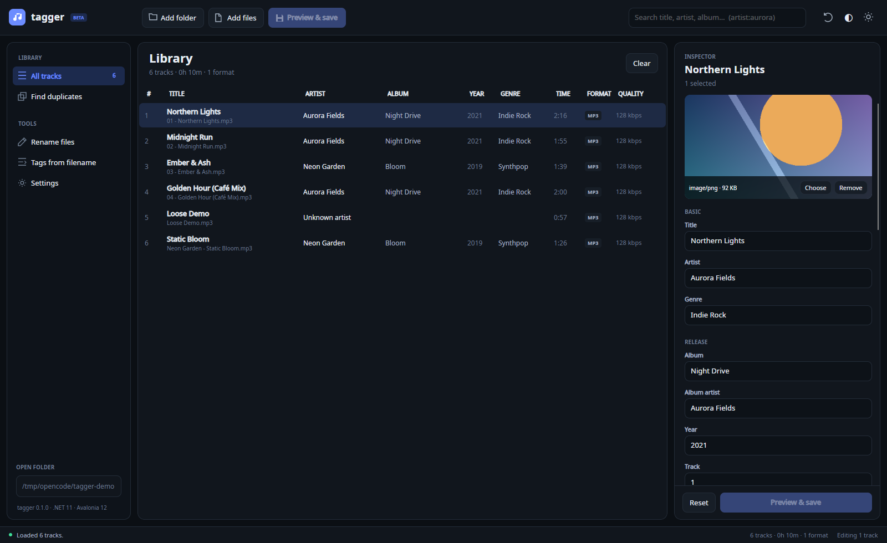
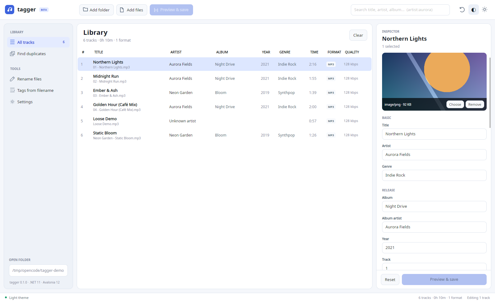
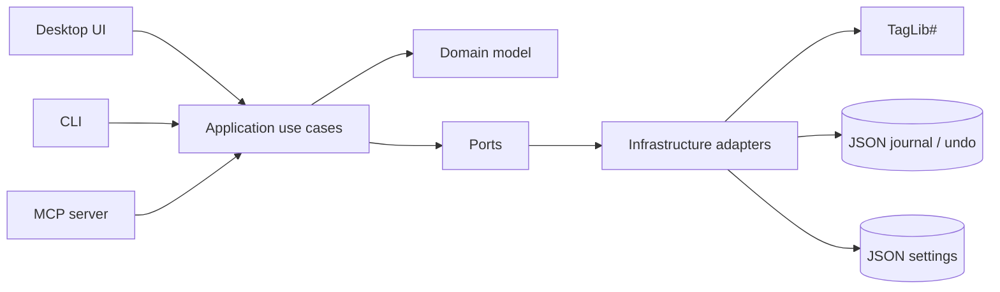

# tagger

**A modern, cross-platform music tag editor — built for people, scriptable by agents.**


`tagger` is an open-source alternative to tools like Mp3tag: a fast, local-first app for editing the metadata of an entire music library, not just one file at a time. It aims to combine the depth of a classic tag editor with a modern interface, first-class batch workflows, and an [MCP](https://modelcontextprotocol.io) server that lets AI assistants work on your library safely.

> **Project status:** early preview. The desktop app, CLI, and MCP server share a working tag
> engine with tag read/write, previews, a change journal, and undo. Packaging, online metadata
> providers, and format-specific compatibility passes are still in progress.

---

## Table of contents

- [Why another tag editor?](#why-another-tag-editor)
- [Features](#features)
- [The interface](#the-interface)
- [MCP: agents that can actually tag](#mcp-agents-that-can-actually-tag)
- [Command line](#command-line)
- [Supported formats](#supported-formats)
- [Configuration](#configuration)
- [Architecture](#architecture)
- [Roadmap](#roadmap)
- [Getting started](#getting-started)
- [FAQ](#faq)
- [Contributing](#contributing)
- [License](#license)

---

## Why another tag editor?

Mp3tag is excellent, but it is Windows-first, its interface shows its age, and it offers little beyond the desktop GUI. Music libraries have changed too: they are larger, they sync across devices, and more people want to automate the boring parts.

`tagger` is built around three ideas:

1. **Cross-platform by default.** The same app, the same feature set, and the same keyboard shortcuts on Windows, macOS, and Linux.
2. **Modern where it matters.** A fast, keyboard-first interface with a command palette, a real inspector, multi-select editing, and instant previews — not a grid from 2004.
3. **Automation as a feature, not an afterthought.** A stable CLI and an MCP server expose the exact same tag engine as the GUI, so scripts and AI agents can do real work with real guardrails.

---

## Features

> The current build implements the desktop library and inspector, previewed tag writes, rename/import,
> artwork, duplicate detection, CLI, and MCP tools. Items called out as planned in the roadmap are
> design targets, not shipped behavior.

### Tag editing that respects your files

- Read and write ID3v1, ID3v2.2/2.3/2.4, Vorbis comments, APEv2, iTunes/MP4 atoms, and RIFF INFO tags.
- Edit individual fields or apply changes across thousands of files in one transaction.
- Preview every change before it is written — a diff of old value → new value, per file.
- Atomic writes with automatic backups and a change journal, so any operation can be undone.
- Preserve unknown frames, embedded artwork, and custom fields when rewriting tags.
- Configurable ID3 version, padding, unsynchronisation, and ID3v1 behavior for maximum player compatibility.

### Library-scale workflows

- Open a folder, an album, or an entire library; virtualized tables stay responsive at 100k+ tracks.
- Filter, sort, and group by any field, including missing or inconsistent values.
- Multi-edit with mixed-value support: change one field across a selection without touching the rest.
- Rename and move files from tags using patterns — and derive tags from existing filenames.
- Case conversion, search-and-replace, numbering, trimming, and other text tools across a selection.
- Find duplicates by tags, audio fingerprint, or both.
- Save tag presets and reusable actions for repeatable cleanup.

### Audition tracks in place

- Play the current selection or double-click a row; `Space` toggles playback and `Ctrl+←`/`Ctrl+→` skip.
- A persistent player bar shows artwork, title, artist, elapsed time, and duration.
- Seek, volume, mute, and repeat off/all/one; volume, mute, and repeat persist across launches.
- The queue follows the visible filtered and sorted order, while next/previous stay stable during playback.
- Playback is desktop-only. The CLI and MCP surfaces never control audio.

### Artwork and metadata

- Embed, replace, extract, and remove cover art (front, back, artist, per-track).
- Fetch release data from MusicBrainz and Discogs, with AcoustID fingerprinting for files with missing or wrong tags.
- Review every proposed match before applying it; no silent rewrites.
- Normalize genres, artists, album artists, and track/disc numbering across an album.

### Built for automation

- A CLI that mirrors the GUI's capabilities and speaks JSON.
- Dry-run and preview modes on every mutating operation.
- An MCP server for Claude, ChatGPT, and other MCP-compatible clients.
- Root-scoped access: agents can only touch directories you explicitly allow.
- Deterministic, logged operations — what an agent did is always inspectable and reversible.

### Local-first and private

- Your library stays on your machine. No account, no telemetry, no cloud sync required.
- Network lookups are opt-in per provider.
- Open file formats and an open change journal — no lock-in.

---

## The interface

The app is organized around four surfaces:

| Surface | What it does |
| --- | --- |
| **Library browser** | Folders, albums, and saved views in a compact sidebar. |
| **Track table** | Dense virtualized multi-select table with sortable columns and inspector editing. |
| **Inspector** | Full metadata for the current selection, including extended frames and artwork. |
| **Action bar** | Batch operations, previews, undo, and quick search (`Ctrl+F`). |
| **Player bar** | Artwork, transport, seek, volume, repeat, and queue position for the current track. |

Design goals:

- **Keyboard-friendly.** Search, save, rename, and undo have shortcuts; the inspector stays out of the way.
- **Preview by default.** Destructive operations are staged in a change set before they are committed.
- **Dark and light themes**, proper high-DPI rendering, and native-feeling window chrome on every OS.
- **No modal overload.** Side panels and inline controls; dialogs are reserved for previews and destructive operations.



*The library browser, multi-select track table, and tag inspector.*



*The same workspace in the light theme.*

---

## MCP: agents that can actually tag

Most "AI for music" tools stop at suggestions. `tagger` exposes its tag engine through the [Model Context Protocol](https://modelcontextprotocol.io), so an assistant can inspect, edit, rename, and organize a library — with the same safety guarantees as the GUI.

### MCP tools in this build

The first eight tools are implemented and share the same engine as the desktop app. Every mutating
tool previews by default and only writes with `commit: true`.

| Tool | Status |
| --- | --- |
| `library_scan` | Implemented |
| `tags_read` | Implemented |
| `tags_write` | Implemented (preview by default) |
| `tags_diff` | Implemented |
| `files_rename` | Implemented (collision-checked) |
| `tags_from_filename` | Implemented (preview by default) |
| `artwork_set` | Implemented (embed/replace/remove) |
| `changes_undo` | Implemented |
| `metadata_lookup` | Planned |
| `duplicates_find` | Built-in duplicate finder; MCP exposure planned |

### Example client configuration

```json
{
  "mcpServers": {
    "tagger": {
      "command": "tagger",
      "args": ["mcp", "--allow", "~/Music"]
    }
  }
}
```

### Example prompts

- "Scan `~/Music/Inbox`, group the files by album, and show me everything missing an album artist."
- "These files are named `Artist - Title.mp3`. Fill in the tags from the filenames, but don't write anything until I approve the preview."
- "Find tracks in `~/Music/Jazz` without cover art and suggest artwork from MusicBrainz."
- "Rename this album to `Artist/Album/NN - Title` and show me the resulting paths first."

### Safety model

Agent access is intentionally boring and predictable:

- **Explicit roots.** The server only sees directories passed via `--allow`.
- **Preview first.** Mutating tools return a diff by default; applying requires an explicit commit.
- **One journal.** Every write goes through the same transaction log as the GUI and can be undone.
- **No surprise network calls.** Online lookups are disabled unless a provider is configured.
- **JSON everywhere.** Every response is structured and testable, not prose.

---

## Command line

The CLI is the automation surface of the same core engine. Current shape:

```bash
# Open the desktop app on a folder
tagger open ~/Music/Inbox

# Inspect tags
tagger read "Artist - Track.mp3" --json

# Edit tags across an album
tagger write ./album --album "Northern Lights" --albumartist "Aurora" --year 2026

# Derive tags from filenames, preview only
tagger from-filename ./album --pattern "%artist% - %title%" --dry-run

# Rename files from tags
tagger rename ./album --pattern "%albumartist%/%album%/%track% - %title%"

# Start the MCP server over a scoped library
tagger mcp --allow ~/Music
```

Common flags: `--dry-run`, `--json`, `--recursive`, `--quiet`, `--config <path>`.

---

## Supported formats

| Format | Extensions | Tag standards | Status |
| --- | --- | --- | --- |
| MP3 | `.mp3` | ID3v1, ID3v2.2/2.3/2.4 | Read/write via TagLib# |
| FLAC | `.flac` | Vorbis comments, FLAC pictures | Read/write via TagLib# |
| Ogg Vorbis / Opus | `.ogg`, `.opus` | Vorbis comments | Read/write via TagLib# |
| MP4 / M4A | `.m4a`, `.mp4`, `.m4b` | iTunes atoms | Read/write via TagLib# |
| WAV | `.wav` | ID3v2, RIFF INFO | Read/write via TagLib# |
| AIFF | `.aiff`, `.aif` | ID3v2 | Read/write via TagLib# |
| APE / WavPack | `.ape`, `.wv` | APEv2 | Read/write via TagLib# |
| WMA | `.wma` | ASF metadata | Read/write via TagLib# |

The format compatibility pass will track gaps per codec, especially ID3 version/padding behavior and
extended frame coverage. Unreadable files are reported, never silently rewritten.

---

## Configuration

`tagger` uses a single JSON settings file:

- **Linux:** `~/.config/tagger/settings.json`
- **macOS:** `~/Library/Application Support/tagger/settings.json`
- **Windows:** `%APPDATA%\tagger\settings.json`

```json
{
  "id3_version": 3,
  "padding": 2048,
  "id3v1": "auto",
  "rename_pattern": "%artist%/%album%/%track% - %title%",
  "autotag_pattern": "%artist% - %title%",
  "recursive": true,
  "last_folder": "/home/me/Music",
  "theme": "dark",
  "always_preview": true,
  "backup_before_write": true,
  "playback_volume": 0.8,
  "playback_muted": false,
  "playback_repeat": "off"
}
```

| Key | Type | Description |
| --- | --- | --- |
| `id3_version` | `2`, `3`, `4` | Reserved for the ID3 compatibility pass. |
| `padding` | integer | Reserved for the ID3 compatibility pass. |
| `id3v1` | `"auto"`, `"on"`, `"off"` | Reserved for the ID3 compatibility pass. |
| `rename_pattern` | string | Default pattern for renaming and moving files. |
| `autotag_pattern` | string | Default pattern for parsing tags out of filenames. |
| `recursive` | boolean | Whether folder operations include subfolders by default. |
| `last_folder` | string | Last opened directory, restored on launch. |
| `theme` | `"dark"`, `"light"`, `"system"` | UI theme. |
| `always_preview` | boolean | Show the diff dialog before every save. |
| `backup_before_write` | boolean | Reserved; writes are already atomic and journaled. |
| `playback_volume` | number | Player volume from `0.0` to `1.0`. |
| `playback_muted` | boolean | Whether playback starts muted. |
| `playback_repeat` | `"off"`, `"all"`, `"one"` | Repeat mode for the playback queue. |

Writes currently use TagLib# defaults for format-specific options. The ID3 values are persisted so the
format compatibility pass can change behavior without migrating settings.

### Pattern tokens

`%artist%`, `%albumartist%`, `%album%`, `%title%`, `%track%`, `%track2%`, `%disc%`, `%year%`, `%genre%`, `%composer%`, `%comment%`, `%ext%`, `%_filename%`

Patterns support zero-padded numbering (`%track2%`, `%track3%`), directories, and drag-free previews. Unknown tokens are rejected before anything is written.

---

## Architecture



The repository is split into small, testable projects:

| Project | Responsibility |
| --- | --- |
| `Tagger.Domain` | Tracks, tag catalog, validation, filename patterns, search, journal records. No UI or I/O. |
| `Tagger.Application` | Use cases and ports: library loading, playback/queue, previews, safe writes, rename/import, artwork, settings, undo, duplicates. |
| `Tagger.Infrastructure` | TagLib# adapter with atomic temp-file writes, LibVLCSharp playback adapter, file scanner, JSON settings/journal, image inspection. |
| `Tagger.Desktop` | Avalonia 12 MVVM UI, compiled bindings, player bar, modern dark/light design system. |
| `Tagger.Cli` | `list`, `read`, `write`, `from-filename`, `rename`, `mcp`. |
| `Tagger.Mcp` | Stdio MCP server with scoped roots and preview-first tools. |

Core principles:

- **One engine, three surfaces.** The GUI, CLI, and MCP server call the same application services.
- **Preview first.** A `ChangeSetPreviewService` produces field-level diffs before writes.
- **Transactional by default.** A batch edit or rename is one journal entry and one undo step.
- **Atomic writes.** Tags are written to a sibling copy and replace the original only after success.
- **Scoped automation.** MCP tools reject paths outside the `--allow` roots.
- **Boring storage.** Settings and the journal are plain JSON; there is no database.
- **Offline first.** The app is fully usable with networking disabled.
- **Self-contained audio.** Windows and macOS use the official LibVLC NuGet packages; Linux ships a
  pinned portable VLC runtime, so users never install VLC separately. See
  [`THIRD-PARTY-NOTICES.md`](THIRD-PARTY-NOTICES.md).

---

## Roadmap

- [x] **Foundations** — tag read/write, atomic writes, change journal, undo.
- [x] **Desktop UI** — library browser, multi-select table, inspector, artwork, dark/light themes.
- [x] **Batch workflows** — rename from tags, tags from filenames, duplicate finder.
- [x] **Audio preview** — player bar, queue, seek, volume, mute, repeat, safe writes while playing.
- [ ] **Text tools and presets** — case conversion, replace, numbering, reusable actions.
- [ ] **Online metadata** — MusicBrainz, Discogs, AcoustID, reviewable autotag previews.
- [x] **Agent surface** — MCP server, scoped roots, dry-run tooling, preview-first tools.
- [ ] **Release** — signed installers for Windows, macOS, and Linux, auto-update, documentation.

The roadmap is directional, not a promise. Priorities will follow real usage.

---

## Getting started

Requirements: .NET 11 SDK, Avalonia 12 runtime dependencies for your desktop.

```bash
# Build everything
dotnet build Tagger.slnx

# Run the full test suite (xUnit v3 + NSubstitute)
dotnet test Tagger.slnx

# Desktop app
dotnet run --project src/Tagger.Desktop

# Linux audio runtime (once; requires Docker).
# The generated directory is gitignored and copied next to the app.
build/libvlc-linux/build.sh

# CLI
dotnet run --project src/Tagger.Cli -- list ~/Music
dotnet run --project src/Tagger.Cli -- read "Artist - Track.mp3"
dotnet run --project src/Tagger.Cli -- write ./album --album "Northern Lights" --dry-run
dotnet run --project src/Tagger.Cli -- rename ./album --pattern "%artist%/%album%/%track% - %title%"

# MCP server (scoped to one or more roots)
dotnet run --project src/Tagger.Mcp -- --allow ~/Music
```

### Project conventions

- Architecture and safety rules live in [`AGENTS.md`](AGENTS.md).
- Reusable agent skills live in [`.opencode/skills`](.opencode/skills).
- Core domain, application, view-model, CLI, and MCP classes have unit tests. The system under test is
  always `_sut` and tests use `Method_ShouldOutcome_WhenCondition` with explicit Arrange/Act/Assert comments.
- UI and logic are decoupled: view models depend on application interfaces, never infrastructure.

Packaging is automated by `.github/workflows/release.yml`. Tagging `v<version>` builds
self-contained portable archives for Windows and Linux and attaches them to a GitHub
release. See [`docs/releasing.md`](docs/releasing.md) for the workflow, signing, and
future installer/AppImage plans.

Current targets:

- **Windows:** portable `.zip` now; signed installer later
- **macOS:** notarized `.dmg` for Apple silicon and Intel (not built yet)
- **Linux:** portable `.tar.gz` now; AppImage and `.deb` later

---

## FAQ

**Is tagger a MusicBrainz Picard replacement?**
No. Picard is an excellent tool for fingerprint-based album matching. `tagger` focuses on fast manual and batch tag editing, with optional metadata lookups as a supporting feature.

**Will it work on a huge library?**
That is a core design constraint. The library index and virtualized views are built for six-figure track counts.

**Does the MCP server let an AI delete my music?**
The server does not expose deletion. It exposes tag edits, renames, and artwork changes inside directories you explicitly allow, with preview-first diffs and a shared undo journal.

**Does it phone home?**
No. There is no account, no analytics, and no background upload. Online metadata providers are opt-in.

**Why "tagger" as a name?**
It says what it does. A distinctive brand can come later.

---

## Contributing

The project is at the early-preview stage, so the most valuable contributions right now are feedback, format edge cases, and workflow ideas.

- Open an issue to discuss a feature or report a bug.
- For anything larger than a small fix, please start a discussion before opening a pull request.
- Keep changes focused, add tests for tag-writing behavior, and never rewrite files without a backup path.
- Read [`AGENTS.md`](AGENTS.md) before changing architecture or UI conventions.

---

## License

MIT. See [`LICENSE`](LICENSE).
