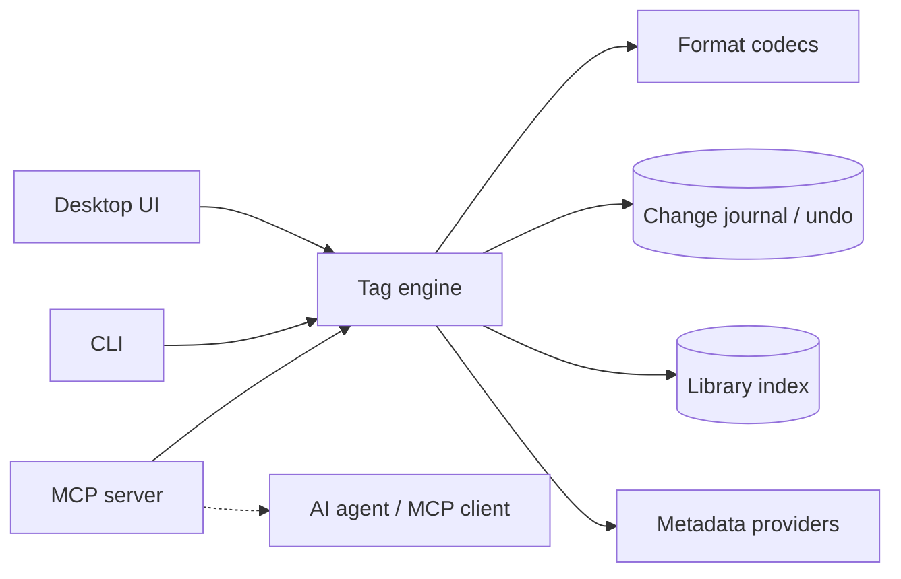

# tagger

**A modern, cross-platform music tag editor — built for people, scriptable by agents.**


`tagger` is an open-source alternative to tools like Mp3tag: a fast, local-first app for editing the metadata of an entire music library, not just one file at a time. It aims to combine the depth of a classic tag editor with a modern interface, first-class batch workflows, and an [MCP](https://modelcontextprotocol.io) server that lets AI assistants work on your library safely.

> **Project status:** pre-alpha. This README describes the intended product and its public interfaces. Nothing is installable yet; commands, config keys, and MCP tool names may change before the first release.

---

## Table of contents

- [Why another tag editor?](#why-another-tag-editor)
- [Features](#features)
- [The interface](#the-interface)
- [MCP: agents that can actually tag](#mcp-agents-that-can-actually-tag)
- [Command line](#command-line)
- [Supported formats](#supported-formats)
- [Configuration](#configuration)
- [Architecture](#architecture)
- [Roadmap](#roadmap)
- [Getting started](#getting-started)
- [FAQ](#faq)
- [Contributing](#contributing)
- [License](#license)

---

## Why another tag editor?

Mp3tag is excellent, but it is Windows-first, its interface shows its age, and it offers little beyond the desktop GUI. Music libraries have changed too: they are larger, they sync across devices, and more people want to automate the boring parts.

`tagger` is built around three ideas:

1. **Cross-platform by default.** The same app, the same feature set, and the same keyboard shortcuts on Windows, macOS, and Linux.
2. **Modern where it matters.** A fast, keyboard-first interface with a command palette, a real inspector, multi-select editing, and instant previews — not a grid from 2004.
3. **Automation as a feature, not an afterthought.** A stable CLI and an MCP server expose the exact same tag engine as the GUI, so scripts and AI agents can do real work with real guardrails.

---

## Features

### Tag editing that respects your files

- Read and write ID3v1, ID3v2.2/2.3/2.4, Vorbis comments, APEv2, iTunes/MP4 atoms, and RIFF INFO tags.
- Edit individual fields or apply changes across thousands of files in one transaction.
- Preview every change before it is written — a diff of old value → new value, per file.
- Atomic writes with automatic backups and a change journal, so any operation can be undone.
- Preserve unknown frames, embedded artwork, and custom fields when rewriting tags.
- Configurable ID3 version, padding, unsynchronisation, and ID3v1 behavior for maximum player compatibility.

### Library-scale workflows

- Open a folder, an album, or an entire library; virtualized tables stay responsive at 100k+ tracks.
- Filter, sort, and group by any field, including missing or inconsistent values.
- Multi-edit with mixed-value support: change one field across a selection without touching the rest.
- Rename and move files from tags using patterns — and derive tags from existing filenames.
- Case conversion, search-and-replace, numbering, trimming, and other text tools across a selection.
- Find duplicates by tags, audio fingerprint, or both.
- Save tag presets and reusable actions for repeatable cleanup.

### Artwork and metadata

- Embed, replace, extract, and remove cover art (front, back, artist, per-track).
- Fetch release data from MusicBrainz and Discogs, with AcoustID fingerprinting for files with missing or wrong tags.
- Review every proposed match before applying it; no silent rewrites.
- Normalize genres, artists, album artists, and track/disc numbering across an album.

### Built for automation

- A CLI that mirrors the GUI's capabilities and speaks JSON.
- Dry-run and preview modes on every mutating operation.
- An MCP server for Claude, ChatGPT, and other MCP-compatible clients.
- Root-scoped access: agents can only touch directories you explicitly allow.
- Deterministic, logged operations — what an agent did is always inspectable and reversible.

### Local-first and private

- Your library stays on your machine. No account, no telemetry, no cloud sync required.
- Network lookups are opt-in per provider.
- Open file formats and an open change journal — no lock-in.

---

## The interface

The app is organized around four surfaces:

| Surface | What it does |
| --- | --- |
| **Library browser** | Folders, albums, and saved views in a compact sidebar. |
| **Track table** | Dense, virtualized, multi-select grid with inline editing and per-column sorting. |
| **Inspector** | Full metadata for the current selection, including extended frames and artwork. |
| **Action bar** | Batch operations, previews, undo, and the command palette (`Ctrl/Cmd + K`). |

Design goals:

- **Keyboard-first.** Navigate, select, edit, and apply without touching the mouse.
- **Preview by default.** Destructive operations are staged in a change set before they are committed.
- **Dark and light themes**, proper high-DPI rendering, and native-feeling window chrome on every OS.
- **No modal overload.** Side panels and inline controls instead of stacked dialogs.

Screenshots will be added with the first preview build.

---

## MCP: agents that can actually tag

Most "AI for music" tools stop at suggestions. `tagger` exposes its tag engine through the [Model Context Protocol](https://modelcontextprotocol.io), so an assistant can inspect, edit, rename, and organize a library — with the same safety guarantees as the GUI.

### Planned MCP tools

| Tool | Purpose |
| --- | --- |
| `library_scan` | Index a directory and report formats, tag coverage, and problems. |
| `tags_read` | Read tags for one file or a batch of files. |
| `tags_write` | Apply field-level patches, with preview and dry-run support. |
| `tags_diff` | Show exactly what a pending change set would modify. |
| `files_rename` | Rename and move files from tag patterns, with collision checks. |
| `tags_from_filename` | Parse filenames into tag fields using a pattern. |
| `artwork_set` | Embed, replace, or remove cover art. |
| `metadata_lookup` | Query MusicBrainz, Discogs, and AcoustID for candidate matches. |
| `duplicates_find` | Find duplicate tracks by tags or audio fingerprint. |
| `changes_undo` | Roll back the most recent transaction. |

### Example client configuration

```json
{
  "mcpServers": {
    "tagger": {
      "command": "tagger",
      "args": ["mcp", "--allow", "~/Music"]
    }
  }
}
```

### Example prompts

- "Scan `~/Music/Inbox`, group the files by album, and show me everything missing an album artist."
- "These files are named `Artist - Title.mp3`. Fill in the tags from the filenames, but don't write anything until I approve the preview."
- "Find tracks in `~/Music/Jazz` without cover art and suggest artwork from MusicBrainz."
- "Rename this album to `Artist/Album/NN - Title` and show me the resulting paths first."

### Safety model

Agent access is intentionally boring and predictable:

- **Explicit roots.** The server only sees directories passed via `--allow`.
- **Preview first.** Mutating tools return a diff by default; applying requires an explicit commit.
- **One journal.** Every write goes through the same transaction log as the GUI and can be undone.
- **No surprise network calls.** Online lookups are disabled unless a provider is configured.
- **JSON everywhere.** Every response is structured and testable, not prose.

---

## Command line

The CLI is the automation surface of the same core engine. Planned shape:

```bash
# Open the desktop app on a folder
tagger open ~/Music/Inbox

# Inspect tags
tagger read "Artist - Track.mp3" --json

# Edit tags across an album
tagger write ./album --album "Northern Lights" --albumartist "Aurora" --year 2026

# Derive tags from filenames, preview only
tagger from-filename ./album --pattern "%artist% - %title%" --dry-run

# Rename files from tags
tagger rename ./album --pattern "%albumartist%/%album%/%track% - %title%"

# Start the MCP server over a scoped library
tagger mcp --allow ~/Music
```

Common flags: `--dry-run`, `--json`, `--recursive`, `--quiet`, `--config <path>`.

---

## Supported formats

| Format | Extensions | Tag standards | Status |
| --- | --- | --- | --- |
| MP3 | `.mp3` | ID3v1, ID3v2.2/2.3/2.4 | Target |
| FLAC | `.flac` | Vorbis comments, FLAC pictures | Target |
| Ogg Vorbis / Opus | `.ogg`, `.opus` | Vorbis comments | Target |
| MP4 / M4A | `.m4a`, `.mp4`, `.m4b` | iTunes atoms | Target |
| WAV | `.wav` | ID3v2, RIFF INFO | Target |
| AIFF | `.aiff`, `.aif` | ID3v2 | Target |
| APE / WavPack | `.ape`, `.wv` | APEv2 | Target |
| WMA | `.wma` | ASF metadata | Target |

"Target" means the format is in scope for the first stable release. Format support is tracked per codec so gaps are visible rather than hidden.

---

## Configuration

`tagger` uses a single JSON settings file:

- **Linux:** `~/.config/tagger/settings.json`
- **macOS:** `~/Library/Application Support/tagger/settings.json`
- **Windows:** `%APPDATA%\tagger\settings.json`

```json
{
  "id3_version": 3,
  "padding": 2048,
  "id3v1": "auto",
  "rename_pattern": "%artist%/%album%/%track% - %title%",
  "autotag_pattern": "%artist% - %title%",
  "recursive": true,
  "last_folder": "/home/me/Music"
}
```

| Key | Type | Description |
| --- | --- | --- |
| `id3_version` | `2`, `3`, `4` | ID3v2 version used when writing MP3 tags. |
| `padding` | integer | Bytes reserved after ID3v2 tags to make future edits faster. |
| `id3v1` | `"auto"`, `"on"`, `"off"` | When to maintain a legacy ID3v1 tag alongside ID3v2. |
| `rename_pattern` | string | Default pattern for renaming and moving files. |
| `autotag_pattern` | string | Default pattern for parsing tags out of filenames. |
| `recursive` | boolean | Whether folder operations include subfolders by default. |
| `last_folder` | string | Last opened directory, restored on launch. |

### Pattern tokens

`%artist%`, `%albumartist%`, `%album%`, `%title%`, `%track%`, `%disc%`, `%year%`, `%genre%`, `%composer%`, `%comment%`, `%ext%`

Patterns support zero-padded numbering and conditional segments (for example, omitting the disc folder for single-disc albums). The exact syntax is finalized with the first implementation.

---

## Architecture



Core principles:

- **One engine, three surfaces.** The GUI, CLI, and MCP server call the same code paths, so they cannot drift apart.
- **Parse, don't guess.** Format detection uses file signatures plus extensions; ambiguous files are reported, not silently rewritten.
- **Transactional by default.** A batch edit is one transaction with one undo entry.
- **Boring storage.** Settings are JSON, the index is disposable, and the journal is inspectable.
- **Offline first.** The app is fully usable with networking disabled.

---

## Roadmap

- [ ] **Foundations** — tag read/write for MP3/FLAC/M4A, atomic writes, change journal.
- [ ] **Desktop UI** — library browser, track table, inspector, multi-select editing, artwork.
- [ ] **Batch workflows** — rename from tags, tags from filenames, text tools, presets, duplicate detection.
- [ ] **Online metadata** — MusicBrainz, Discogs, AcoustID, reviewable autotag previews.
- [ ] **Agent surface** — MCP server, scoped roots, dry-run tooling, end-to-end safety tests.
- [ ] **Release** — signed installers for Windows, macOS, and Linux, auto-update, documentation.

The roadmap is directional, not a promise. Priorities will follow real usage.

---

## Getting started

There is no installable build yet. Development setup and packaging instructions will land with the first preview release; until then, this repository is the place to follow design decisions and early commits.

When builds are available, the intended installation paths are:

- **Windows:** installer (`.exe`) and portable build
- **macOS:** notarized `.dmg` for Apple silicon and Intel
- **Linux:** AppImage, `.deb`, and Flatpak

---

## FAQ

**Is tagger a MusicBrainz Picard replacement?**
No. Picard is an excellent tool for fingerprint-based album matching. `tagger` focuses on fast manual and batch tag editing, with optional metadata lookups as a supporting feature.

**Will it work on a huge library?**
That is a core design constraint. The library index and virtualized views are built for six-figure track counts.

**Does the MCP server let an AI delete my music?**
The server does not expose deletion. It exposes tag edits, renames, and artwork changes inside directories you explicitly allow, with preview-first diffs and a shared undo journal.

**Does it phone home?**
No. There is no account, no analytics, and no background upload. Online metadata providers are opt-in.

**Why "tagger" as a name?**
It says what it does. A distinctive brand can come later.

---

## Contributing

The project is at the design-and-foundations stage, so the most valuable contributions right now are feedback, format edge cases, and workflow ideas.

- Open an issue to discuss a feature or report a bug.
- For anything larger than a small fix, please start a discussion before opening a pull request.
- Keep changes focused, add tests for tag-writing behavior, and never rewrite files without a backup path.

A `CONTRIBUTING.md` and code of conduct will be added with the first code drop.

---

## License

`tagger` is intended to be released under the [MIT License](https://opensource.org/licenses/MIT). A `LICENSE` file will be added with the first public release.
