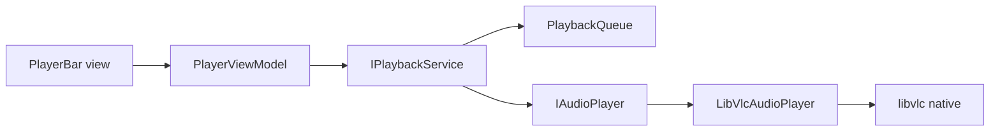

# Audio playback — implementation plan

**Status:** implemented (desktop playback; Windows/macOS native packages, bundled Linux runtime)  
**Scope:** desktop app (`Tagger.Desktop`)  
**Goal:** let users audition tracks in the library without leaving tagger, with a persistent
now-playing bar, transport controls, seeking, volume, and sequential play through the visible
library.

---

## 1. Scope and non-goals

### In scope (v1)

- Play local audio files already loaded into the library.
- Play/pause, stop, next, previous, seek, volume, mute.
- A now-playing bar showing artwork, title, artist, elapsed time, and duration.
- Play the current selection, or double-click / press Enter on a row.
- Auto-advance through a queue built from the **currently visible** tracks, in display order.
- Repeat off / all / one.
- Persist volume and mute state in `settings.json`.
- Playback failure handling that never crashes the app.
- Safe interaction with tag writes, renames, undo, and library reloads.

### Out of scope (explicitly deferred)

- Streaming or network URLs.
- Playlist persistence, drag-to-reorder queue, “play next / add to queue”.
- Waveform, spectrum, visualizer, EQ, ReplayGain, crossfade, gapless tuning.
- OS media integration (Windows SMTC, macOS Now Playing, Linux MPRIS/media keys).
- Output-device selection.
- Playback from CLI or MCP. Agents must not control audio.

The plan keeps all of these possible later by putting playback behind an application port and a
queue service.

---

## 2. Current state

- `Track` already carries everything the player bar needs:
  `FilePath`, `DisplayTitle`, `DisplayArtist`, `DisplayAlbum`, `CoverArt`, and
  `Audio.Duration` (`Tagger.Domain/Tracks/Track.cs`).
- The library is already in memory as `MainWindowViewModel.VisibleTracks` (filtered and sorted)
  and `_allTracks` (the full set).
- `src/Tagger.Infrastructure/Playback/` exists but is empty.
- There is no audio dependency in `Directory.Packages.props`, no player view, and no settings for
  playback.
- View models must not call infrastructure directly (`AGENTS.md`), so playback needs an
  Application-layer port and a Desktop composition-root registration.
- Tag writes use a sibling temp file and then replace the original
  (`TagLibTrackRepository`). On Windows this can fail if a player still holds the destination file
  open, so file mutation must coordinate with playback.

---

## 3. Backend decision (Phase 0 gate)

Playback is the only part of this feature that cannot be exercised by unit tests. Pick the backend
with a short spike before building the UI. Both options stay behind the same port, so the decision
is reversible.

| Option | Strengths | Costs / risks |
| --- | --- | --- |
| **LibVLCSharp** (recommended) | Mature media-player semantics: play, pause, seek, end-of-media, volume, broad codec coverage (MP3, FLAC, OGG/Opus, M4A/AAC, WAV, AIFF, APE, WV, WMA). Used widely in desktop players. | LGPL native `libvlc`; Windows/macOS native NuGet packages, Linux needs the distro `libvlc` runtime; ~50–100 MB packaged; must handle a missing native library gracefully. |
| **SoundFlow + FFmpeg codecs** | MIT, managed API, self-contained NuGet, cross-platform, no system package on Linux; good fit for a local-first app. | Built-in decoding is WAV/MP3/FLAC; OGG/Opus/M4A/AAC need the FFmpeg codec package (additional native dependency + LGPL FFmpeg notices). Player/queue semantics are lower-level, so more adapter work. Maintainer is on hiatus in 2026. |
| NAudio / CSCore | Simple Windows API. | Windows-only — rejected. |
| Shell out to an external player | No native dependency. | No transport, seek, position, or end-of-track events — rejected. |

**Recommendation:** LibVLCSharp for v1. It gives the most reliable play/seek/end semantics and
format coverage for a music-library player, which is the point of the feature. Keep the adapter
thin so SoundFlow can replace it if packaging or Linux deployment proves painful.

**Implementation result (2026-11):** LibVLCSharp 3.10.2 shipped. Windows and macOS use the
official native NuGet packages. Linux bundles a portable VLC 3.0.16 runtime built from pinned
Ubuntu 22.04 packages; the app loads it with `dlopen` + a `DllImportResolver` and a native
`setenv("VLC_PLUGIN_PATH", …)`, so no `LD_LIBRARY_PATH`, re-exec, or system VLC is required.
Audio playback was verified on Linux with the bundled runtime, including end-of-media, seek,
pause/resume, volume, mute, next/previous, repeat-all, and graceful failure for a missing file.

Pin current stable versions centrally in `Directory.Packages.props` (checked November 2026:
`LibVLCSharp` 3.10.2, `VideoLAN.LibVLC.Windows` 3.0.24, `VideoLAN.LibVLC.Mac` 3.1.3.2).

**Phase 0 exit criteria**

- Audible playback of MP3, FLAC, OGG, M4A, and WAV on the development machine.
- Position updates, seek, pause/resume, volume, mute, and end-of-media events observed.
- App starts and remains usable when `libvlc` is missing; playback commands surface a clear
  “playback unavailable” failure instead of crashing.
- Confirm licensing/notice requirements and rough output size.

If Phase 0 fails the criteria, switch the recommendation to SoundFlow before Phase 2 and keep the
same Application/Desktop contracts.

---

## 4. Target architecture



### 4.1 Application — pure playback contract and queue

New folder `src/Tagger.Application/Playback/`.

```csharp
public enum PlaybackState { Idle, Opening, Playing, Paused, Stopped, Ended, Failed }

public enum RepeatMode { Off, All, One }

public sealed record PlaybackSnapshot(
    PlaybackState State,
    TimeSpan Position,
    TimeSpan Duration,
    double Volume,
    bool IsMuted,
    string? FilePath,
    string? Error);

public sealed record PlaybackFailure(string FilePath, string Message);

public sealed record PlaybackRequest(
    string FilePath,
    TimeSpan StartPosition,
    string? DisplayTitle);
```

**Low-level port** (one media at a time; no queue logic):

```csharp
public interface IAudioPlayer : IDisposable
{
    event EventHandler<PlaybackSnapshot>? SnapshotChanged;
    event EventHandler<PlaybackFailure>? Failed;
    event EventHandler? PlaybackEnded;

    Task<bool> PlayAsync(PlaybackRequest request, CancellationToken cancellationToken = default);
    void Pause();
    void Resume();
    void Stop();
    void Seek(TimeSpan position);
    void SetVolume(double volume);   // 0.0–1.0
    void SetMuted(bool muted);
}
```

**Queue math** (pure, fully unit-testable):

```csharp
public sealed class PlaybackQueue
{
    public IReadOnlyList<Track> Items { get; }
    public int CurrentIndex { get; }
    public Track? Current { get; }
    public bool HasNext(RepeatMode repeat);
    public bool HasPrevious(RepeatMode repeat);
    public Track? MoveNext(RepeatMode repeat);      // wraps only for RepeatMode.All
    public Track? MovePrevious(RepeatMode repeat);
    public void RemovePaths(IReadOnlyList<string> paths);
    public void UpdateTrack(Track track, string? previousPath = null); // after save/rename
}
```

**Orchestration** used by the UI:

```csharp
public interface IPlaybackService
{
    PlaybackSnapshot Snapshot { get; }
    Track? CurrentTrack { get; }
    RepeatMode Repeat { get; }
    bool CanGoNext { get; }
    bool CanGoPrevious { get; }

    event EventHandler<PlaybackSnapshot>? StateChanged;
    event EventHandler? CurrentTrackChanged;
    event EventHandler<PlaybackFailure>? Failed;

    Task PlayAsync(
        IReadOnlyList<Track> queue, int startIndex,
        CancellationToken cancellationToken = default);
    Task ToggleAsync(CancellationToken cancellationToken = default);
    Task NextAsync(CancellationToken cancellationToken = default);
    Task PreviousAsync(CancellationToken cancellationToken = default);
    void Stop();
    void Seek(TimeSpan position);
    void SetVolume(double volume);
    void SetMuted(bool muted);
    void SetRepeat(RepeatMode repeat);
    void RemoveFromQueue(IReadOnlyList<string> paths);
    void UpdateTrack(Track track, string? previousPath = null);
}
```

`PlaybackService` owns the queue, serializes commands with a `SemaphoreSlim`, maps
`IAudioPlayer.PlaybackEnded` to auto-advance, and maps player failures to its `Failed` event. It
contains no Avalonia types and no native calls.

**Why split queue and service?** `PlaybackQueue` is deterministic and tested without mocks;
`PlaybackService` tests the state machine with a mocked `IAudioPlayer`; the adapter only translates
native events.

### 4.2 Infrastructure — backend adapter

New files in the existing `src/Tagger.Infrastructure/Playback/`:

- `LibVlcAudioPlayer.cs` — lazily initializes `LibVLC` (`--no-video`, `--quiet`), reuses one
  `MediaPlayer`, creates one `Media` per request, and maps native events.
- `VlcPlaybackMapper.cs` — pure mappings: libVLC state → `PlaybackState`, `0–100` volume →
  `0.0–1.0`, native error → user-facing message, duration normalization.
- `UnavailableAudioPlayer.cs` — optional fallback that reports a structured failure when the native
  library cannot be initialized.

Adapter rules:

- Never throw from commands. Translate `DllNotFoundException`, `VLCInitException`, and
  `EncounteredError` into `PlaybackFailure`.
- All native events are raised on background threads; do no UI work in the adapter.
- Throttle position notifications to roughly 4 per second and only raise when the whole-second
  value changes.
- Normalize `-1` / unknown time and duration to zero.
- Dispose the `Media`, `MediaPlayer`, and `LibVLC` instance deterministically.
- Allow a native-library path override (`TAGGER_LIBVLC_PATH`) for Linux and packaging.

Native package plan:

- `LibVLCSharp` (managed) in `Directory.Packages.props`.
- `VideoLAN.LibVLC.Windows` and `VideoLAN.LibVLC.Mac` for desktop builds.
- Linux: bundle the runtime (see `build/libvlc-linux`). System libVLC is only a development
  fallback when the bundle is absent; do not silently assume it is present.
- Add third-party notices for LibVLC (LGPL 2.1+) and LibVLCSharp (MIT).

### 4.3 Desktop — UI and composition

- `PlayerViewModel` (new) depends on `IPlaybackService` and a tiny `IUiDispatcher` so background
  events are marshalled to the Avalonia UI thread.
  - `AvaloniaUiDispatcher` wraps `Dispatcher.UIThread.Post`; tests use an immediate fake.
- `PlayerBar.axaml` (new `UserControl`) with `x:DataType="vm:PlayerViewModel"`.
- `MainWindowViewModel` owns `Player` and builds the queue from `VisibleTracks` in visible order.
- `Bootstrapper` registers `IAudioPlayer` → `LibVlcAudioPlayer`, `IPlaybackService` →
  `PlaybackService`, `IUiDispatcher` → `AvaloniaUiDispatcher`, and `PlayerViewModel`.
- `App.axaml.cs` disposes the playback service on application exit.
- `SettingsViewModel` does not need new fields: it already preserves fields it does not know about
  via `_original with { ... }`, so volume/mute survive a settings-dialog save.

---

## 5. Behavior specification

### 5.1 Queue

- The queue is a **snapshot of `VisibleTracks`** at the moment playback starts, in current display
  order (filtered and sorted). Next/previous follow that snapshot; changing search or sort does not
  reshuffle an in-flight queue.
- Starting from a row selects that row as the current item; starting from a selection starts at the
  first selected row in visible order.
- Double-click or Enter plays a row; single selection never auto-plays.
- “Play selection” is available from the inspector/action bar when at least one row is selected.
- If a track is removed from the library, remove it from the queue. If it was current, stop.
- If a tag save updates a queued track, replace the snapshot and refresh the player bar metadata.

### 5.2 Transport

| Action | Behavior |
| --- | --- |
| Play | Open the file and start at time zero. |
| Pause | Pause; position is retained. |
| Resume / toggle | Resume from the retained position. |
| Stop | Stop, release the media, reset position to zero, return to `Stopped`. Never auto-advance. |
| Next | Advance if possible; at the end, wrap only for `Repeat.All`. |
| Previous | If position > 3 s, restart the current track; otherwise go back. |
| End of media | Auto-advance for `Repeat.Off`/`All`; replay for `Repeat.One`. |
| Repeat | Off → stop at end; All → wrap; One → replay current. |
| Seek | Clamp to `[0, duration]`; ignore while idle. Seek during `Opening` is applied once ready. |
| Volume | `0.0–1.0`, applied immediately and stored in settings. |
| Mute | Independent of volume; unmute restores the previous volume. |
| Failure | Enter `Failed`, show the message, keep the current queue index. Do **not** silently skip an unplayable file. |

### 5.3 State machine

```text
Idle ──play──> Opening ──ready──> Playing <──resume──> Paused
                  │                  │  │                │
                  │                  │  └──pause─────────┘
                  │                  └──end──> Ended ──repeat──> Opening / Play
                  ├──error──> Failed
                  └──stop───> Stopped ──play──> Opening

Stop from Playing/Paused ──> Stopped (position reset)
```

Additional rules:

- Serialize `PlayAsync` / `Next` / `Previous` / `Toggle` so rapid double-clicks cannot open two
  media files at once.
- Ignore a late `PlaybackEnded` event if the current track has already changed (generation token or
  path check).
- Do not auto-advance on failure. Leave the failed track current so the user can retry or press next.
- The player bar shows `Opening…` while a file is being probed and `Paused`/`Playing` accurately.

### 5.4 Interaction with file mutations (safety)

Tag writes, renames, and undo can touch the file libVLC has open.

- Before a save or rename that includes the current track, call a playback “prepare for mutation”
  operation:
  - capture `{ filePath, position, wasPlaying }`,
  - stop and release the file handle,
  - perform the write/rename,
  - reopen the new path and seek back to the captured position if the file still exists and
    `wasPlaying`.
- On Windows this avoids `File.Move(..., overwrite: true)` failing on an open destination.
- Undo may touch an unknown set of files; conservatively stop, then reopen at the captured position
  after the reload.
- Unloading the current track (`RemoveSelection`, `ClearLibrary`) stops playback; the file itself is
  untouched.
- If a file disappears between queue construction and playback, fail gracefully and keep the app
  responsive.

---

## 6. UI design

### 6.1 Layout

Insert a player bar between the workspace and the status bar:

```text
MainWindow grid rows: 64 (top bar) / * (workspace) / Auto (player bar) / 30 (status bar)
```

`PlayerBar` height ~64–72 px, `SurfaceBrush` background, a 1 px top border, no shadow.

```
[artwork]  Title                          ⟲   ⟳     ————————●—————— 1:42 / 4:18   🔊 ————●——
           Artist · Album                  ⏮  ▶/⏸  ⏭                          3 / 42 tracks
```

- Left: 44×44 rounded artwork thumbnail, title (13 px semibold), artist/album (11 px muted).
- Center: previous, play/pause, next, then a seek slider with elapsed/total text.
- Right: repeat toggle, volume slider, mute toggle, queue position (`3 / 42`).
- Empty state: “Nothing playing — double-click a track or press Space”, transport disabled.
- Show the bar whenever the library has tracks, so playback is discoverable and the layout does not
  jump on first play.
- Hide the bar entirely when the library is empty.

### 6.2 Interaction details

- Double-click a row or press Enter to play that row.
- `Space` toggles play/pause when focus is not in a `TextBox` or other text editor.
- `Ctrl+Right` / `Ctrl+Left` next / previous.
- Slider behavior: while dragging, show the dragged time and suppress player-driven position
  updates (`IsSeeking` guard); issue the seek on drag completion. Do not seek on every pointer move.
- Volume slider updates immediately; persist on close or with a short debounce, never on every tick.
- Repeat button cycles Off → All → One with distinct tooltips and an active visual state.
- The currently playing row gets a subtle accent marker or equalizer glyph; add `IsCurrent` to
  `TrackRowViewModel` and update it when `CurrentTrackChanged` fires.
- Disable transport buttons when there is no current track; disable next/previous at queue ends
  unless repeat-all is active.
- Busy states: library scans and tag saves must not disable playback unless the playing file is
  being mutated (see 5.4). Playback must not block the UI thread.

### 6.3 Visual language and accessibility

- Reuse `Themes/Tokens.axaml`; no hard-coded colors.
- Path-based icons consistent with the existing toolbar, or plain text glyphs already used in the
  app. Buttons use `IconButtonTheme` / `ToolButtonTheme`.
- `AutomationProperties.Name` on play/pause, previous, next, repeat, mute, and both sliders.
- Tooltips include keyboard shortcuts.
- Keyboard focus order: transport → seek → volume → repeat. Do not steal focus when playback starts.
- Error messages appear in the player bar (short) and in the main status bar; long errors get a
  dialog only if the user explicitly retries.

---

## 7. Implementation phases

Estimates assume one developer; the Phase 0 gate can change the backend without affecting later
phases.

### Phase 0 — backend spike (0.5–2 days)

1. Add `LibVLCSharp` and native package references.
2. Throwaway console or temporary adapter: play, pause, resume, seek, volume, end event.
3. Verify MP3, FLAC, OGG, M4A, WAV on Linux (and Windows/macOS if available).
4. Verify the app can start with `libvlc` absent.
5. Record the decision and update this document.

**Exit:** go/no-go on the backend; known codec gaps documented.

### Phase 1 — Application playback core (2–3 days)

1. Add playback records and enums.
2. Add `IAudioPlayer` and `IPlaybackService`.
3. Implement `PlaybackQueue` (no mocks needed).
4. Implement `PlaybackService` with command serialization, auto-advance, repeat, previous-restart,
   failure propagation, and queue pruning.
5. Unit tests for queue and service (see §8).

**Exit:** all playback logic is testable without native audio; `dotnet test` green.

### Phase 2 — Infrastructure adapter (2–3 days)

1. Implement `LibVlcAudioPlayer` and `VlcPlaybackMapper`.
2. Add lazy native initialization, structured failures, event throttling, and disposal.
3. Add pure mapper tests.
4. Manually verify the native behavior matrix.

**Exit:** playback works through `IPlaybackService` on the dev machine; missing libvlc degrades
gracefully.

### Phase 3 — Desktop UI (3–4 days)

1. Add `IUiDispatcher` / `AvaloniaUiDispatcher`.
2. Add `PlayerViewModel` with observable state and commands.
3. Add `PlayerBar.axaml` and its code-behind (initialization only).
4. Insert the bar into `MainWindow.axaml`; update the grid.
5. Wire double-click/Enter, Space, Ctrl+Left/Right.
6. Build the queue from `VisibleTracks`; add `IsCurrent` to rows.
7. Register everything in `Bootstrapper`; dispose on app exit.
8. Initialize volume/mute from `AppSettings`; persist on exit/debounce.
9. Add `PlayerViewModel` tests.

**Exit:** the feature is usable end-to-end; `dotnet run --project src/Tagger.Desktop` plays audio.

### Phase 4 — Safety and polish (1–2 days)

1. Add prepare/restore around save, rename, and undo (5.4).
2. Handle unload/clear/missing/renamed current tracks.
3. Add repeat cycle, previous-restart, row indicator, and empty states.
4. Add accessibility names, tooltips, and focus behavior.
5. Persist volume/mute and add shutdown disposal.
6. Surface playback failures consistently.
7. Cross-check Windows/macOS file locking.

**Exit:** no data-loss or lock-related regressions; app exits without orphaned audio.

### Phase 5 — verification and documentation (1 day)

1. Run the full manual matrix (§9).
2. Update `README.md` features/roadmap: “Audio preview/playback”.
3. Document the Linux `libvlc` runtime requirement and third-party notices.
4. Record follow-ups (media keys, queue persistence, device selection, gapless).

---

## 8. Testing plan (per `AGENTS.md`)

New test classes use `_sut`, explicit `// Arrange` / `// Act` / `// Assert`, and mock only
interfaces.

### `tests/Tagger.Application.Tests/Playback/PlaybackQueueTests.cs`

Pure domain-style tests (no mocks):

- `MoveNext_ShouldReturnNextTrack_WhenQueueHasNext`
- `MoveNext_ShouldReturnNull_WhenAtEndAndRepeatOff`
- `MoveNext_ShouldWrapToFirst_WhenAtEndAndRepeatAll`
- `MovePrevious_ShouldRestartCurrent_WhenPositionBeyondThreshold`
- `MovePrevious_ShouldReturnPreviousTrack_WhenQueueHasPrevious`
- `RemovePaths_ShouldKeepCurrentTrack_WhenAnEarlierTrackIsRemoved`
- `RemovePaths_ShouldClearCurrent_WhenCurrentTrackIsRemoved`
- `UpdateTrack_ShouldReplaceItem_WhenPathMatches`
- `UpdateTrack_ShouldReplaceRenamedItem_WhenPreviousPathMatches`

### `tests/Tagger.Application.Tests/Playback/PlaybackServiceTests.cs`

Mock `IAudioPlayer`:

- `PlayAsync_ShouldOpenSelectedTrack_WhenQueueStartsInMiddle`
- `PlayAsync_ShouldExposeCurrentTrack_WhenPlayerAcceptsMedia`
- `ToggleAsync_ShouldPause_WhenStateIsPlaying`
- `ToggleAsync_ShouldResume_WhenStateIsPaused`
- `NextAsync_ShouldAdvance_WhenQueueHasNext`
- `NextAsync_ShouldStop_WhenAtEndAndRepeatOff`
- `NextAsync_ShouldWrap_WhenAtEndAndRepeatAll`
- `PreviousAsync_ShouldRestart_WhenPositionBeyondThreshold`
- `HandleEnded_ShouldAdvance_WhenRepeatOffAndNextExists`
- `HandleEnded_ShouldReplay_WhenRepeatOne`
- `HandleEnded_ShouldNotAdvance_WhenTrackChangedMeanwhile`
- `PlayerFailure_ShouldExposeFailureAndKeepCurrent_WhenMediaFails`
- `Stop_ShouldNotAutoAdvance_WhenEndArrivesAfterStop`
- `SetVolume_ShouldClampAndForward_WhenOutOfRange`
- `RemoveFromQueue_ShouldStop_WhenCurrentTrackIsRemoved`

### `tests/Tagger.Infrastructure.Tests/Playback/VlcPlaybackMapperTests.cs`

Pure mapping tests, no native initialization:

- `MapState_ShouldReturn..._WhenNativeStateIs...`
- `MapVolume_ShouldClamp_WhenNativeVolumeIsOutOfRange`
- `MapError_ShouldUseReadableMessage_WhenCodecIsUnsupported`
- `NormalizeDuration_ShouldReturnZero_WhenDurationIsMinusOne`

### `tests/Tagger.Desktop.Tests/PlayerViewModelTests.cs`

Mock `IPlaybackService`; use an immediate `IUiDispatcher`:

- `TogglePlayPauseCommand_ShouldCallService_WhenTrackIsLoaded`
- `PlayTrackCommand_ShouldBuildQueueFromVisibleOrder_WhenInvoked`
- `PreviousCommand_ShouldBeDisabled_WhenAtQueueStart`
- `PositionText_ShouldFormatMinutesAndHours_WhenDurationCrossesAnHour`
- `SeekCommand_ShouldClampToDuration_WhenValueExceedsTrackLength`
- `Volume_ShouldForwardToService_WhenSliderChanges`
- `Failure_ShouldSetErrorMessage_WhenServiceReportsFailure`
- `CurrentTrackChanged_ShouldRefreshArtworkAndMetadata`
- `Dispose_ShouldUnsubscribeAndStop_WhenWindowCloses`

### `MainWindowViewModelTests.cs` additions

- `PlaySelectedCommand_ShouldPassVisibleTracksAndStartIndex_WhenSelectionExists`
- `SaveAsync_ShouldStopCurrentTrack_WhenPlayingFileIsInSelection`
- `ReloadPathsAsync_ShouldRefreshPlayerMetadata_WhenCurrentTrackWasWritten`

No real audio, sleeps, clocks, or native libraries in unit tests.

---

## 9. Manual verification matrix

Run on Linux, Windows, and macOS before calling this done.

| Area | Check |
| --- | --- |
| Formats | MP3, FLAC, OGG/Opus, M4A, WAV play; unsupported/corrupt files show a failure and do not crash. |
| Transport | Play, pause, resume, stop, next, previous, end-of-queue, repeat off/all/one. |
| Seek | Drag while playing and while paused; seek near the end; seek before media is ready. |
| Queue | Start from middle, filter/search during playback, sort during playback, remove the current row, clear the library. |
| Metadata | Title/artist/artwork update after a tag save; renamed file keeps playback correct. |
| File locks | Save tags and rename the currently playing file on Windows; verify no `IOException`. |
| Safety | Undo a write while playing; unload the current track; close the app while playing. |
| Failure | Rename/delete the backing file outside the app, then press next/retry. |
| UI | Empty state, disabled states, keyboard shortcuts, focus in the search box, high DPI, dark/light themes. |
| Startup | Launch with libvlc missing; app remains usable with a clear “playback unavailable” message. |

Automated UI smoke test is optional; if added, use Avalonia headless tests for bindings and command
wiring, not native audio.

---

## 10. Risks and mitigations

| Risk | Mitigation |
| --- | --- |
| Native libvlc missing or fails to load | Lazy init, structured failure, “playback unavailable” state, startup without audio, docs per platform. |
| Packaged size grows significantly | Keep the adapter isolated; document size; consider a separate `Tagger.Playback` project referenced only by Desktop if CLI/MCP size matters. |
| Windows file locking during tag writes | Prepare/stop/reopen around mutations; verify with the manual matrix. |
| Position events flood the UI thread | Throttle and marshal via `IUiDispatcher`; update text only when seconds change. |
| Slider feedback loop | `IsSeeking` guard + seek on drag completion. |
| Stale queue after library changes | Path-based queue, remove/update methods, stop if current is removed. |
| Double-click opens two tracks | Serialize playback commands; generation token for late end events. |
| Orphaned audio after exit | Dispose the player/service on app exit and window close. |
| Format gaps surprise users | Phase 0 codec matrix; clear per-file failure message; never silently skip. |
| Backend churn | Port + queue + view model are backend-agnostic; only Phase 2 changes. |

---

## 11. File-by-file change list

**New — Application**

- `src/Tagger.Application/Playback/PlaybackState.cs`
- `src/Tagger.Application/Playback/RepeatMode.cs`
- `src/Tagger.Application/Playback/PlaybackSnapshot.cs`
- `src/Tagger.Application/Playback/PlaybackFailure.cs`
- `src/Tagger.Application/Playback/PlaybackRequest.cs`
- `src/Tagger.Application/Playback/IAudioPlayer.cs`
- `src/Tagger.Application/Playback/IPlaybackService.cs`
- `src/Tagger.Application/Playback/PlaybackQueue.cs`
- `src/Tagger.Application/Playback/PlaybackService.cs`

**New — Infrastructure**

- `src/Tagger.Infrastructure/Playback/LibVlcAudioPlayer.cs`
- `src/Tagger.Infrastructure/Playback/VlcPlaybackMapper.cs`
- `src/Tagger.Infrastructure/Playback/UnavailableAudioPlayer.cs` (only if lazy fallback is not
  handled inside `LibVlcAudioPlayer`)

**New — Desktop**

- `src/Tagger.Desktop/Services/IUiDispatcher.cs`
- `src/Tagger.Desktop/Services/AvaloniaUiDispatcher.cs`
- `src/Tagger.Desktop/ViewModels/PlayerViewModel.cs` (+ `.Commands.cs` if it exceeds ~150 lines)
- `src/Tagger.Desktop/Views/PlayerBar.axaml`
- `src/Tagger.Desktop/Views/PlayerBar.axaml.cs` (initialization only)

**Changed**

- `Directory.Packages.props` — LibVLCSharp + native packages.
- `src/Tagger.Infrastructure/Tagger.Infrastructure.csproj` — package references.
- `src/Tagger.Desktop/Bootstrapper.cs` — register player, service, dispatcher, view model.
- `src/Tagger.Desktop/App.axaml.cs` — dispose playback on exit.
- `src/Tagger.Desktop/ViewModels/MainWindowViewModel.cs` — `Player` property, initialization,
  settings persistence.
- `src/Tagger.Desktop/ViewModels/MainWindowViewModel.Commands.cs` — play selection, mutation
  guards.
- `src/Tagger.Desktop/ViewModels/MainWindowViewModel.Library.cs` — queue/metadata sync on reload,
  update, remove, clear.
- `src/Tagger.Desktop/ViewModels/TrackRowViewModel.cs` — `IsCurrent` indicator.
- `src/Tagger.Desktop/Views/MainWindow.axaml` — player row, bindings, keyboard shortcuts.
- `src/Tagger.Desktop/Views/MainWindow.axaml.cs` — double-tap/Enter forwarding, Space focus guard,
  closing disposal.
- `src/Tagger.Application/Settings/AppSettings.cs` — `PlaybackVolume`, `PlaybackMuted`.
- `README.md` — feature/roadmap and Linux runtime note.
- `tests/*` — new playback test classes and `MainWindowViewModelTests` additions.

---

## 12. Definition of done (feature)

1. Double-click/Enter plays a track; Space toggles; next/previous and auto-advance work.
2. Seek, volume, mute, and repeat behave as specified; volume/mute persist across restarts.
3. The queue follows the visible filtered/sorted order and is stable during playback.
4. The bar shows the current artwork, title, artist, elapsed time, and duration.
5. Unsupported, corrupt, or missing files fail gracefully with a visible message.
6. Writing, renaming, or undoing the currently playing file does not lock or corrupt it.
7. No Avalonia or infrastructure types leak into Domain/Application; view models depend on
   Application interfaces only.
8. `dotnet build Tagger.slnx` and `dotnet test Tagger.slnx` pass.
9. The app runs and plays audio on Windows, macOS, and Linux; it still launches without libvlc.
10. New production classes have tests in the required `_sut` + AAA pattern.

---

## 13. Open questions

1. **Backend:** confirm LibVLCSharp after Phase 0, or prefer the self-contained SoundFlow stack?
2. **Bar visibility:** always visible when the library is non-empty (proposed), or only after the
   first play?
3. **Queue semantics:** snapshot of visible tracks (proposed) or a live view of the current filter?
4. **Previous behavior:** restart after 3 seconds (proposed) or always go to the previous track?
5. **Resume after writes:** reopen at the saved position (proposed polish) or simply stop when the
   playing file is mutated in v1?
6. **OS media keys / MPRIS:** leave for a follow-up release (proposed) or include in v1?
